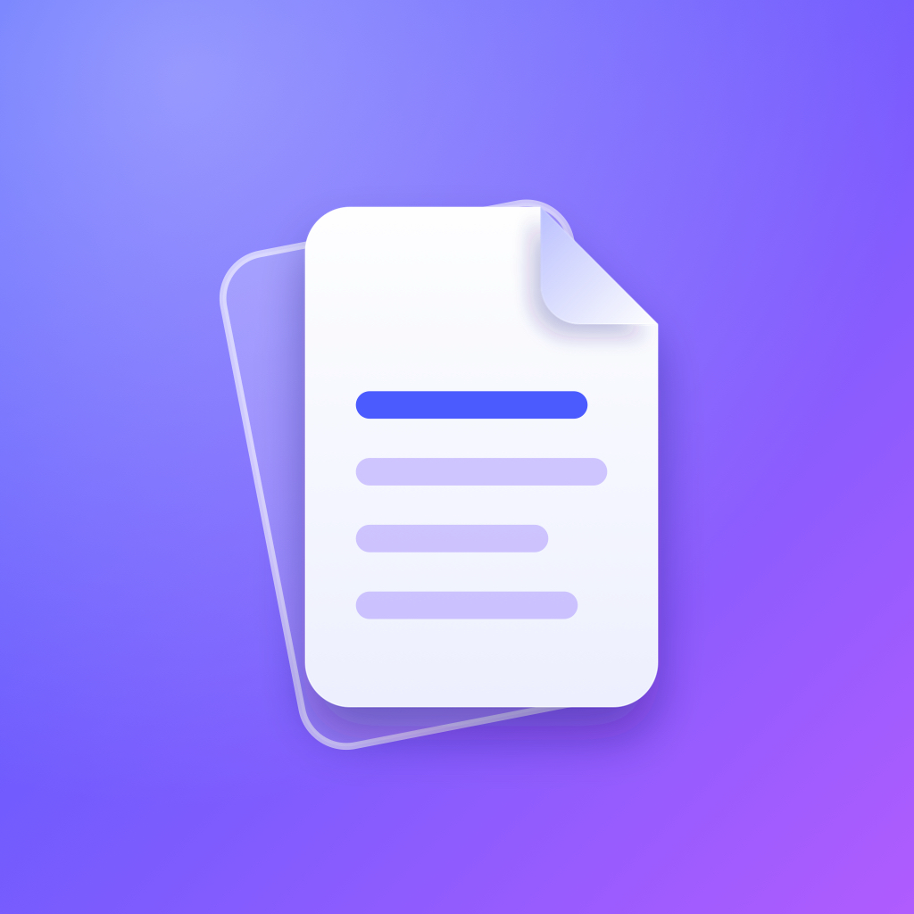

# Pagecrane



All-in-one, on-device PDF & image utility for iOS and Android: scan, merge, split, compress, resize, convert, sign.

| Deliverable | Where |
|---|---|
| Architecture, Flutter project layout, packages | [docs/ARCHITECTURE.md](docs/ARCHITECTURE.md) §1–2 |
| Screen-by-screen user flow (13 screens) | [docs/ARCHITECTURE.md](docs/ARCHITECTURE.md) §3 |
| Color palette, type, motion, haptics, a11y | [docs/ARCHITECTURE.md](docs/ARCHITECTURE.md) §4 |
| Key algorithms (target-KB, PDF compression estimate, filters, edge detection) | [docs/ARCHITECTURE.md](docs/ARCHITECTURE.md) §5 |
| Clickable prototype (dashboard + scanner) | [prototype/](prototype/index.html) |
| Name + app icon: **Pagecrane** with the Fold icon (PDFit and Pagefold are both taken on the App Store) | Options: [Design/brand-board.html](Design/brand-board.html) · master: `Design/AppIcon-Pagecrane.svg` · export all sizes: `zsh Design/export-icons.sh` |

## Flutter app (`app/`)

Flutter 3.50 / Dart 3.14, Riverpod 3, go_router 18, Material 3 (`material_ui`). iOS plugins use Swift Package Manager, so CocoaPods isn't needed.

```bash
cd app && flutter run
```

| Works now | Not built yet |
|---|---|
| Glass shell: Home · Files · Scan FAB · Tools · Settings, light/dark/system | Imported PDFs are rasterised: no selectable text, and text-only PDFs grow (e.g. 45 KB → 1.6 MB; Compress helps) |
| **Import PDF** (scan sheet, Tools, Files header): pick from Files, password prompt, PDFium renders pages at 200 DPI → normal library doc, so every tool works on it | |
| **PDF → images**: pick pages, JPG/PNG, Original / 2000 / 1200 px, JPG quality → share sheet (Save to Photos, Files, AirDrop…) | |
| **Split**: extract pages (tap or type “1-3, 7”) or every N pages; original kept | Text comments as PDF annotations (marks are flattened into the page image) |
| **Sign & annotate**: pen, highlighter, text, signature pad (remembered on device); move, pinch-resize, undo; flattened into the page at full resolution on Save | |
| **Camera scan**: native VisionKit (iOS) / ML Kit (Android) via `cunning_document_scanner` | Secure Vault, OCR search |
| **Import photos → auto-crop** (Dart port of the prototype's detector + perspective warp) | Android not yet built or run (no Android SDK on this Mac) |
| Review: 5 filters, rotate, reorder, delete, add pages, apply to all | Camera path untested: the simulator has no camera |
| Save → page JPEGs + thumbnail + PDF in the app sandbox (`index.json` library) | |
| Merge (drag to reorder), Compress (Low/Med/High with sampled estimates) | |
| Compress to size ("under 100 KB") and resize by %, share sheet export | |
| Files: search, sort, starred, folders · Doc viewer: zoom, share, rename, delete | |

Heavy work (decode, filters, warp, PDF build) runs off the UI thread via `compute(topLevelFn, arg)`. Don't use `Isolate.run(() => …)` closures inside async methods: they can capture unsendable async state and crash. Tests (`flutter test`, 22) cover auto-crop, filters, target-size compression, the PDF builder, page-range parsing, PDF import (incl. a PDFium round trip), Split (against a temp-dir repository), flattening annotations, signature normalisation and a dashboard smoke test.

## Run the prototype

```bash
python3 -m http.server 5178 --directory prototype
```

Open http://localhost:5178. Use a phone-sized window, or open it on your phone over the LAN. A camera needs `localhost` or HTTPS.

### What's real vs. mocked

| Works for real (in the browser) | Mocked / native-build only |
|---|---|
| Camera preview, live page detection (Otsu + largest blob + corner extraction), steadiness lock, auto-capture | Detection is a simple heuristic: it expects a light page on a darker surface. The app uses VisionKit / ML Kit |
| Perspective warp at full camera resolution, 5 filters (Magic Color, Grayscale, B&W, Photo, Original), rotate, batch | Sample documents in recents are placeholders |
| Save → real JPEG sizes; Export / share as PDF (jsPDF, lazy-loaded from cdnjs) | Merge runs on sample files (simulated) |
| Compress: real re-encode + sampled estimate for scanned docs | Compress on sample files uses typical ratios |
| Image → **under N KB** (binary search on quality, then downscale), resize by %, format, quality | Split, Sign/annotate, PDF→JPG, HEIC→JPG, Vault (marked "Native") |
| Images → multi-page PDF | |
| Files: search, sort, starred, folders; light/dark/system theme; haptics (Android vibrate) | |

If no camera is available, the scanner falls back to a **demo scene**: a sheet on a desk, settling like a hand-held phone. The real detection pipeline still runs on it. Tap the pill under the status to switch between the camera and the demo.
